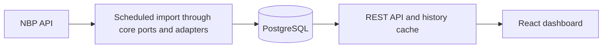

# Currency Monitor

[Polski](#polski) | [English — jump to the English version](#english)

## Polski

Currency Monitor pobiera średnie kursy walut Narodowego Banku Polskiego
(NBP), zapisuje obserwacje w PostgreSQL i prezentuje je w panelu po polsku.
Projekt łączy modułowy backend Java, frontend React i automatyczne wdrożenia Docker.

### Funkcje

- Cykliczny import tabeli A NBP z ochroną przed duplikatami dla waluty i daty.
- Wyszukiwanie i sortowanie walut, najnowsze notowania oraz wykresy historii.
- Przeliczanie PLN i innych walut na podstawie opublikowanych kursów średnich.
- Eksport CSV i lista obserwowanych zapisywana lokalnie w przeglądarce.
- REST API, cache historii Caffeine i obsługa pustych danych oraz błędów w interfejsie.

### Szybki start

Zainstaluj Docker z Compose i uruchom go przed wykonaniem poniższych poleceń
w katalogu głównym repozytorium. Na Windows użyj Git Bash lub skopiuj plik
środowiska w PowerShell poleceniem `Copy-Item .env.example .env`.
Utwórz `.env` tylko wtedy, gdy plik jeszcze nie istnieje.

```bash
cp .env.example .env
docker compose up --build
```

| Usługa | Adres lokalny |
| --- | --- |
| Panel | http://localhost:3000 |
| API walut | http://localhost:8080/api/currencies |
| Swagger UI (tylko lokalnie) | http://localhost:8080/swagger-ui/index.html |

Porty lokalne są dostępne przez localhost. PostgreSQL jest dostępny tylko
w sieci Compose. Nowa baza jest początkowo pusta; notowania pojawią się po
pierwszym udanym imporcie NBP. Zajęte porty możesz zmienić w `.env`.

```bash
docker compose logs -f backend
docker compose down
```

Zatrzymanie kontenerów zachowuje bazę. Dodanie `-v` do `down` usuwa wolumen
z danymi tego zestawu kontenerów.

### Architektura

Backend składa się z czterech modułów Maven. Logika importu korzysta z portów
niezależnych od frameworków, implementowanych przez adaptery NBP i JPA.
Odczyty API korzystają bezpośrednio z repozytoriów JPA, więc cała aplikacja
nie wymusza jednego przepływu architektury heksagonalnej.



**Technologie:** Java 17, Spring Boot 3.5, Maven, PostgreSQL 16, JPA/Hibernate,
Flyway, Caffeine, React 19, TypeScript, Vite, Nginx i Docker Compose.

### API

| Endpoint | Odpowiedź |
| --- | --- |
| `GET /api/currencies` | Kody i nazwy walut |
| `GET /api/rates/{code}/latest` | Najnowsza zapisana data publikacji i kurs średni |
| `GET /api/rates/{code}` | Zapisana historia, od najnowszych obserwacji |

Swagger działa lokalnie i jest wyłączony w profilu produkcyjnym.

### Weryfikacja i wdrożenie

```bash
cd currency-monitor-backend
bash ./mvnw -B verify
cd ../currency-monitor-frontend
npm ci
npm run lint
npm run build
npm audit
```

Testy backendu obejmują import, adaptery, repozytoria, odpowiedzi API,
prywatność logów oraz migrację i uruchomienie profilu produkcyjnego na H2.
JaCoCo wymaga 70% pokrycia instrukcji w core, persistence i kliencie NBP;
moduł aplikacyjny jest wyłączony z tej kontroli. Repozytorium zawiera konfigurację
Playwright, ale nie zawiera zestawu testów przeglądarkowych.

Pull requesty uruchamiają testy backendu i skryptów wdrożenia, walidację Compose
oraz lint i build frontendu. Push do `main` dodatkowo buduje obrazy GHCR,
sprawdza produkcyjny zestaw kontenerów z PostgreSQL i wdraża go na VPS przez SSH.

### Obecne ograniczenia

- Historia powstaje z zebranych obserwacji; wcześniejsze dane NBP nie są importowane wstecz.
- Backend importuje co 30 sekund, co nie oznacza nowych publikacji NBP.
  Odświeżenie panelu odczytuje backend i nie uruchamia importu NBP.
- Lista obserwowanych należy do jednej przeglądarki. Logowanie i API kont nie są wdrożone.
- Historia nie ma paginacji. Wdrożenie korzysta z jednego VPS i może powodować
  krótką przerwę podczas wymiany kontenerów.

### Dokumentacja

- [Architektura i decyzje projektowe](docs/ARCHITECTURE.md#polski)
- [Model danych](docs/DATA_MODEL.md#polski)
- [Praca lokalna](docs/DEVELOPMENT.md#polski)
- [Wdrożenie produkcyjne, backup i rollback](ops/DEPLOYMENT.md#polski)

[Przejdź do wersji angielskiej ↓](#english)

---

## English

[Wróć do wersji polskiej ↑](#polski)

Currency Monitor collects mean exchange rates from the National Bank of Poland
(NBP), stores observations in PostgreSQL and presents them in a Polish-language
dashboard. The project combines a modular Java backend with a React frontend and
an automated Docker deployment pipeline.

### Features

- Scheduled import of NBP Table A, with duplicate prevention per currency and date.
- Searchable and sortable currency catalogue, latest quotes and historical charts.
- PLN and cross-currency conversion using published mean rates.
- CSV export and a watchlist saved in browser local storage.
- REST API, Caffeine history cache and explicit empty/error states in the UI.

### Quick start

Install Docker with Compose and start Docker before running these commands from
the repository root. On Windows, use Git Bash or copy the environment file in
PowerShell with `Copy-Item .env.example .env`. Create `.env` only if it does not
already exist.

```bash
cp .env.example .env
docker compose up --build
```

| Service | Local address |
| --- | --- |
| Dashboard | http://localhost:3000 |
| Currency API | http://localhost:8080/api/currencies |
| Swagger UI (development only) | http://localhost:8080/swagger-ui/index.html |

Local ports bind to localhost. PostgreSQL is available only inside the Compose
network. A new database is initially empty; quotes appear after the first
successful NBP import. Change host ports in `.env` if they are already in use.

```bash
docker compose logs -f backend
docker compose down
```

Stopping the stack preserves its database. Adding `-v` to `down` deletes the
stack's database volume.

### Architecture

The backend uses four Maven modules. Import logic depends on framework-free
ports; NBP and JPA adapters implement those ports. API reads use JPA repositories
directly, so the whole application does not enforce a single hexagonal flow.


**Stack:** Java 17, Spring Boot 3.5, Maven, PostgreSQL 16, JPA/Hibernate, Flyway,
Caffeine, React 19, TypeScript, Vite, Nginx and Docker Compose.

### API

| Endpoint | Response |
| --- | --- |
| `GET /api/currencies` | Currency codes and names |
| `GET /api/rates/{code}/latest` | Latest stored publication date and mean rate |
| `GET /api/rates/{code}` | Stored history, ordered from newest to oldest |

Swagger is enabled locally and disabled in the production profile.

### Verification and deployment

```bash
cd currency-monitor-backend
bash ./mvnw -B verify
cd ../currency-monitor-frontend
npm ci
npm run lint
npm run build
npm audit
```

Backend tests cover import behavior, adapters, repositories, API responses,
logging privacy and migration/startup with the production profile on H2.
JaCoCo enforces 70% instruction coverage in core, persistence and NBP client;
the application module is excluded from that coverage gate. The repository has
Playwright configuration but no committed browser test suite.

Pull requests run backend and deployment-script tests, Compose validation, and
frontend lint/build. Pushes to `main` additionally build GHCR images, check the
production stack with PostgreSQL and deploy to a VPS over SSH.

### Current limitations

- History accumulates from collected observations; earlier NBP history is not backfilled.
- The backend imports every 30 seconds; this does not imply new NBP publications.
  Dashboard refresh reads the backend and does not trigger an NBP import.
- The watchlist belongs to one browser. There is no implemented login or account API.
- History responses are not paginated. The deployment uses one VPS and may briefly
  interrupt service when containers are replaced.

### Documentation

- [Architecture and design decisions](docs/ARCHITECTURE.md#english)
- [Database model](docs/DATA_MODEL.md#english)
- [Local development](docs/DEVELOPMENT.md#english)
- [Production deployment, backups and rollback](ops/DEPLOYMENT.md#english)

[Back to the top ↑](#polski)
