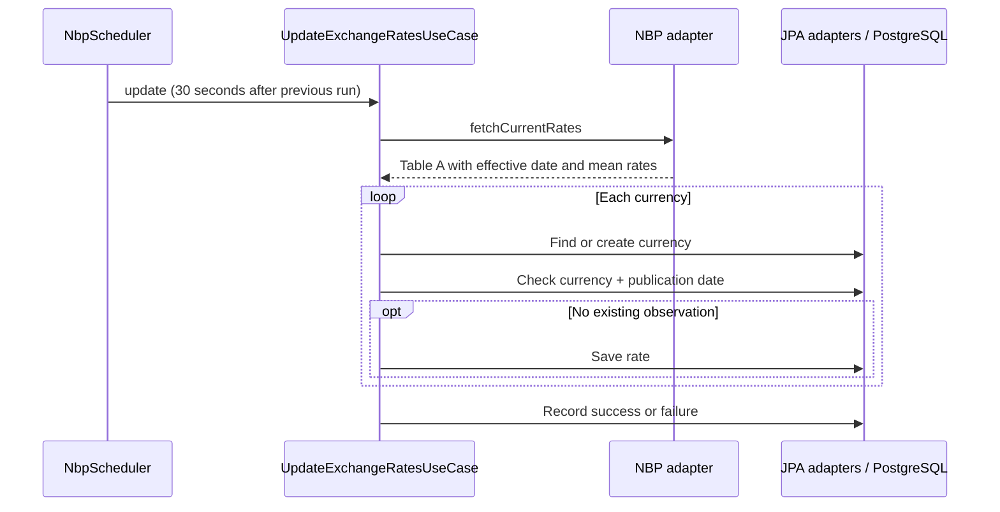
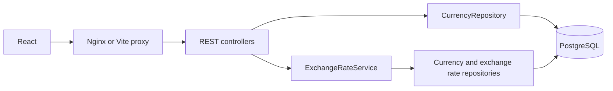

# Architektura / Architecture

[Polski](#polski) | [English — jump to the English version](#english)

## Polski

Projekt oddziela cykliczny import NBP od zależności infrastrukturalnych.
Publiczne REST API korzysta z prostszego odczytu opartego na repozytoriach.

### Moduły backendu

| Moduł | Odpowiedzialność |
| --- | --- |
| `currency-monitor-core` | Snapshoty, porty i przypadek użycia importu, niezależne od frameworków |
| `currency-monitor-nbp-client` | Klient HTTPS NBP i mapowanie DTO NBP na dane core |
| `currency-monitor-persistence` | Encje JPA, repozytoria i implementacje portów zapisu oraz logowania |
| `currency-monitor-app` | Konfiguracja Spring, scheduler, kontrolery, serwis odczytu, cache i obsługa błędów |

Core nie zależy w czasie działania od Spring ani JPA. Aplikacja łączy implementacje
`ExchangeRateProvider`, `CurrencyPort`, `ExchangeRatePort` i `ApiFetchLogPort`.

### Przepływ importu

Importer sprawdza istniejące obserwacje, a baza dodatkowo wymusza unikalność
pary waluta/data. Pobierana jest aktualna tabela, bez uzupełniania wcześniejszych
dat. Błędy są zapisywane w `api_fetch_logs`, a kolejny cykl może ponowić próbę.
Import całej tabeli nie jest jedną atomową transakcją: część rekordów może zostać
zapisana przed wystąpieniem błędu.

### Przepływ odczytu

CurrencyController odczytuje repozytorium walut bezpośrednio. ExchangeRateService
korzysta z repozytoriów do pobierania najnowszych notowań i historii. Metoda historii
używa cache Caffeine z czasem ważności 30 sekund i limitem 100 wpisów;
adnotacja cache nie obejmuje metody najnowszego notowania.

### Decyzje i kompromisy

- **Porty wokół importu:** przypadek użycia można testować bez HTTP, Spring i bazy.
- **Bezpośrednie repozytoria w odczytach:** mniej warstw dla małego API tylko do odczytu,
  kosztem silniejszego powiązania modułu aplikacyjnego z persistence.
- **Data publikacji jako tożsamość obserwacji:** wielokrotne pobranie nie tworzy
  kolejnego notowania dla tej samej waluty i daty.
- **Krótki cache historii:** powtarzane zapytania ograniczają odczyty bazy,
  ale nowe obserwacje mogą pojawić się w tej metodzie z niewielkim opóźnieniem.
- **Osobna konfiguracja lokalna i produkcyjna:** lokalnie schemat aktualizuje Hibernate,
  a produkcja używa wersjonowanych migracji Flyway i walidacji Hibernate.

Frontend odczytuje backend co 60 sekund, gdy karta jest widoczna, i ogranicza
równoległe zapytania o najnowsze notowania do sześciu. Obserwowane waluty są
zapisywane w local storage. Czas odczytu API i data publikacji NBP to osobne wartości.

### Weryfikacja

Testy backendu sprawdzają udany import, duplikaty i awarie, adaptery i repozytoria,
odpowiedzi REST oraz prywatność błędów i logów. Test profilu produkcyjnego
uruchamia Flyway i walidację Hibernate na H2 w trybie zgodności z PostgreSQL.
CI dodatkowo uruchamia rzeczywisty produkcyjny zestaw kontenerów z PostgreSQL
przed wdrożeniem na VPS; H2 nie zastępuje tego testu.

[Przejdź do wersji angielskiej ↓](#english)

---

## English

[Wróć do wersji polskiej ↑](#polski)

The project separates the scheduled NBP import from infrastructure dependencies.
It also uses a simpler repository-based read path for the public REST API.

### Backend modules

| Module | Responsibility |
| --- | --- |
| `currency-monitor-core` | Framework-free snapshots, ports and the import use case |
| `currency-monitor-nbp-client` | HTTPS NBP client and conversion of NBP DTOs into core data |
| `currency-monitor-persistence` | JPA entities, repositories and implementations of core storage/logging ports |
| `currency-monitor-app` | Spring configuration, scheduling, controllers, read service, cache and error handling |

Core has no runtime dependency on Spring or JPA. The application wires the
implementations of `ExchangeRateProvider`, `CurrencyPort`, `ExchangeRatePort`
and `ApiFetchLogPort`.

### Import flow

The importer checks for existing observations and the database also enforces a
unique currency/date constraint. It fetches the current table, rather than
backfilling historical dates. Errors are recorded in `api_fetch_logs` and a later
scheduled run can retry. The import is not one atomic transaction across the
whole table: some rows can be saved before a failure.

### Read flow

CurrencyController reads the currency repository directly. ExchangeRateService
reads repositories for latest quotes and history. The history method uses a
Caffeine cache with a 30-second expiry and at most 100 entries; latest quotes are
not cached by that annotation.

### Decisions and tradeoffs

- **Ports around import:** the use case can be tested without HTTP, Spring or a database.
- **Direct repositories for reads:** fewer layers for a small read-only API, with
  tighter coupling between the application and persistence modules.
- **Publication date as observation identity:** repeated polling does not create
  another quote for the same currency and date.
- **Short history cache:** repeated history requests avoid database reads, at the
  cost of a brief delay before new observations appear through that method.
- **Separate development/production configuration:** development uses Hibernate
  schema updates; production uses versioned Flyway migrations and Hibernate validation.

The frontend reads the backend every 60 seconds while the tab is visible and
limits concurrent latest-quote requests to six. Favourites live in browser local
storage. API read time and NBP publication date are separate values.

### Verification

Backend tests exercise import success, duplicate handling and failures, storage
adapters/repositories, REST output and privacy of errors/logs. A production-profile
test runs Flyway and Hibernate validation against H2 in PostgreSQL compatibility
mode. CI additionally starts the actual PostgreSQL production stack before a VPS
deployment; H2 is not a substitute for that smoke check.

[Back to the top ↑](#polski)
