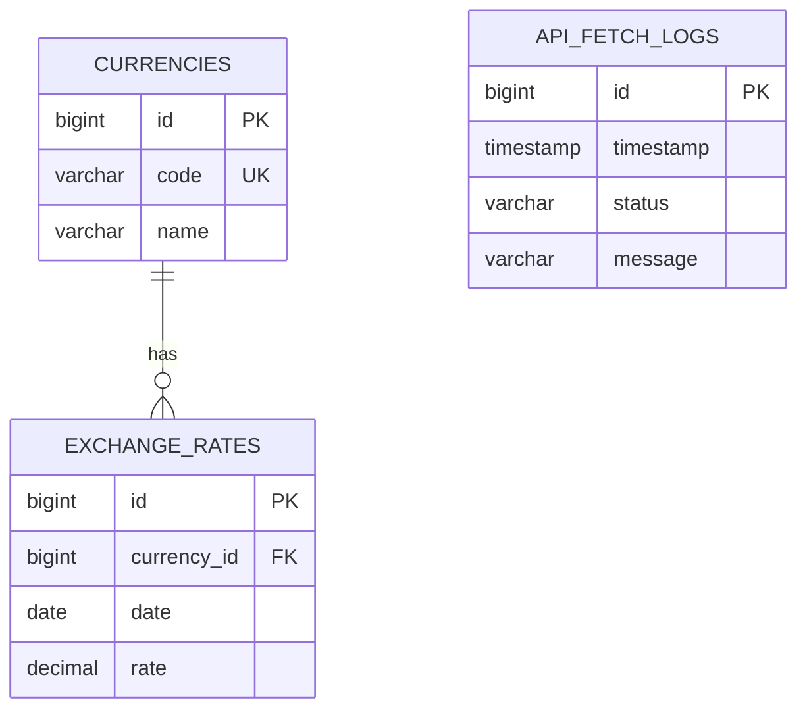

# Model danych / Database model

[Polski](#polski) | [English — jump to the English version](#english)

## Polski

Encje JPA znajdują się w `currency-monitor-persistence`. Core korzysta ze snapshotów
i rekordów danych portów, a nie z encji oznaczonych adnotacjami JPA. Schemat
produkcyjny definiuje [migracja V1](../currency-monitor-backend/currency-monitor-app/src/main/resources/db/migration/V1__initial_schema.sql).

### Tabele używane przez obecną aplikację

| Tabela | Przeznaczenie | Ważne ograniczenie |
| --- | --- | --- |
| `currencies` | Kod i nazwa waluty | Unikalny kod, maksymalnie trzy znaki |
| `exchange_rates` | Kurs średni i data publikacji NBP | Unikalna para waluta/data; precyzja 19, skala 4 |
| `api_fetch_logs` | Czas, status i komunikat próby importu | Komunikat do 500 znaków |

Zapisana data to data publikacji NBP, a nie uruchomienia importera. Istniejąca
obserwacja dla waluty i daty jest zachowywana, zamiast nadpisywana przy każdym
pobraniu. Publiczne endpointy zwracają DTO z kodem/nazwą waluty albo kursem/datą,
a nie całe encje lub wewnętrzne logi importu.

### Schemat przygotowany pod przyszłe konta

Schemat i encje zawierają również `users`, `roles`, `user_roles` oraz
`observed_currencies`. Użytkownik może mieć wiele ról i obserwowanych walut;
`observed_currencies` wymusza unikalną parę użytkownik/waluta.

Te tabele nie oznaczają wdrożonego uwierzytelniania ani API kont. Obecna lista
obserwowanych na frontendzie korzysta z local storage i nie zapisuje danych
w tych tabelach. Funkcje kont wymagałyby uwierzytelniania, autoryzacji i haszowania
haseł przed udostępnieniem operacji użytkowników. Istniejące migracje produkcyjne
są zachowane; nie należy usuwać nieużywanych tabel przez edycję zastosowanej migracji.

[Przejdź do wersji angielskiej ↓](#english)

---

## English

[Wróć do wersji polskiej ↑](#polski)

JPA entities belong to `currency-monitor-persistence`. Core uses snapshots and
port data records, rather than annotated persistence entities. The production
schema is defined in [migration V1](../currency-monitor-backend/currency-monitor-app/src/main/resources/db/migration/V1__initial_schema.sql).

### Tables used by the current application

| Table | Purpose | Important constraint |
| --- | --- | --- |
| `currencies` | Currency code and name | Unique code, at most three characters |
| `exchange_rates` | Mean rate and NBP publication date | Unique currency/date; decimal precision 19, scale 4 |
| `api_fetch_logs` | Time, status and message for an import attempt | Message limited to 500 characters |

A stored date is the NBP publication date, not the time the importer ran. The
importer preserves an existing currency/date observation rather than overwriting
it on every poll. Public endpoints return DTOs with currency code/name or rate/date,
not complete entities or internal import logs.

### Schema prepared for future account features

The schema and entities also contain `users`, `roles`, `user_roles` and
`observed_currencies`. Users can have multiple roles and observed currencies;
`observed_currencies` has a unique user/currency pair.

These tables are not an implemented authentication or account API. The current
frontend watchlist uses browser local storage and does not write to these tables.
Account features would require authentication, authorization and password hashing
before exposing user operations. Existing production migrations are preserved;
unused tables should not be removed by editing a migration already applied.

[Back to the top ↑](#polski)
